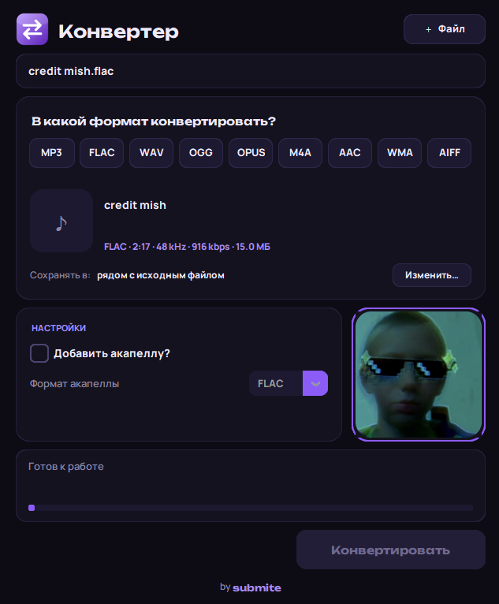

<div align="center">


# Конвертер

**Правый клик → «Конвертировать…» → выбери формат. Всё.**

Быстрый конвертер аудио, видео и изображений, встроенный в контекстное меню Windows.
А ещё он умеет вырезать из трека акапеллу и минус.




</div>

---

## Возможности

- **Живёт в контекстном меню.** Не нужно открывать отдельную программу и искать файл: правый клик по файлу, и окно с выбором формата уже перед тобой.
- **Аудио:** MP3, FLAC, WAV, OGG, OPUS, M4A, AAC, WMA, AIFF. Обложка и теги сохраняются для MP3, FLAC и M4A, битрейт выбирается.
- **Видео:** MP4, MKV, MOV, AVI, WEBM, GIF.
- **Звук из видео:** вытащить дорожку в любой аудиоформат, например MP4 → MP3.
- **Изображения:** PNG, JPG, WEBP, BMP, GIF, TIFF, ICO, PDF, с ползунком качества для JPG и WEBP.
- **Акапелла и минус.** Одна галочка, и нейросеть [Demucs](https://github.com/facebookresearch/demucs) делит трек на вокал и инструментал.
- **Карточка «О файле».** Обложка или кадр из видео, теги, длительность, битрейт и размер до начала конвертации.
- **Своя папка для результата** или рядом с исходником (по умолчанию).
- **Несколько файлов сразу.** Выдели пачку файлов, и все откроются в одном окне.

## Быстро

| Что | Как это работает |
|---|---|
| Пакетная обработка | Несколько файлов конвертируются одновременно |
| Без перекодирования | Если контейнер позволяет (например, MKV ↔ MP4), потоки просто переливаются: это занимает доли секунды и без потери качества |
| Видеокарта | Видео кодируется на NVIDIA (NVENC) или AMD (AMF), а если их нет, то на процессоре |
| Мгновенный запуск | После закрытия окно ещё 10 минут ждёт в фоне, и следующий запуск открывается сразу |
| Акапелла | PyTorch и модель подгружаются в фоне, пока ты выбираешь формат |

## Установка

**Нужно:** Windows 10/11 и [Python 3.10+](https://www.python.org/downloads/) (при установке отметь «Add Python to PATH»).

```bash
git clone https://github.com/<submitea>/<convector>.git
cd <convector>/converter

winget install Gyan.FFmpeg      # ffmpeg, один раз
install.bat                     # поставит библиотеки и добавит пункт в меню
```

После установки перезапусти Проводник или перезагрузи компьютер (чтобы он увидел ffmpeg).

### Акапелла (необязательно)

```bash
python -m pip install demucs
```

Пакет тяжёлый (около 2 ГБ вместе с PyTorch), а при первом запуске он скачает модель (~80 МБ). С видеокартой NVIDIA разделение идёт в разы быстрее, если поставить сборку PyTorch с CUDA.

## Использование

1. Правый клик по файлу → **«Конвертировать…»**
2. Выбери формат (повторный клик по нему снимает выбор).
3. Нажми **«Конвертировать»**, готовый файл появится рядом с исходным.

> **Windows 11:** пункт находится в старом меню, то есть после «Показать дополнительные параметры» (или `Shift+F10`).
> Чтобы он был сразу виден по правому клику, можно вернуть полное классическое меню:
> ```bash
> python install.py --classic-menu on     # включить
> python install.py --classic-menu off    # вернуть как было
> ```

## Удаление

```bash
uninstall.bat
```

Пункт меню удаляется из реестра. Прав администратора для установки и удаления не нужно, всё хранится в `HKEY_CURRENT_USER`.

## Как это устроено

```
converter/
├── main.py          точка входа, запускается из контекстного меню
├── gui.py           окно (customtkinter, тёмно-фиолетовая тема)
├── core.py          вся конвертация: ffmpeg, Pillow, Demucs
├── install.py       добавляет и убирает пункт в контекстном меню (реестр)
├── install.bat / uninstall.bat
├── requirements.txt
└── assets/          иконка, шрифты, картинка
```

- **ffmpeg** занимается аудио и видео, **Pillow** картинками, **Demucs** (модель `htdemucs`) акапеллой.
- Если выделить сразу много файлов, Windows запускает программу по разу на каждый. Первый процесс открывает окно, остальные передают ему пути по локальному сокету и сразу завершаются.
- Интерфейс подгоняет высоту окна под содержимое, а долгие операции идут в фоновых потоках, поэтому окно не зависает.

## Настройки

| Что | Где |
|---|---|
| Фоновое ожидание после закрытия (мин.), `0` отключает | `KEEP_ALIVE_MIN` в `gui.py` |
| Свой ffmpeg без установки в систему | положи `ffmpeg.exe` и `ffprobe.exe` в `converter/ffmpeg/` |

## Частые вопросы

**«ffmpeg не найден».** Установи его (`winget install Gyan.FFmpeg`) и перезапусти Проводник или компьютер. Либо положи `ffmpeg.exe` и `ffprobe.exe` в папку `converter/ffmpeg/`.

**Пункта нет в меню.** В Windows 11 загляни в «Показать дополнительные параметры» или включи классическое меню (см. выше).

**«Для акапеллы нужен Demucs».** Выполни `python -m pip install demucs`.

**Ошибка при запуске.** Текст ошибки сохраняется в `converter/error.log`.

## Технологии

Python · [customtkinter](https://github.com/TomSchimansky/CustomTkinter) · [Pillow](https://python-pillow.org/) · [FFmpeg](https://ffmpeg.org/) · [Demucs](https://github.com/facebookresearch/demucs)

## Лицензии и благодарности

- Код проекта распространяется по лицензии **MIT**.
- Шрифты [Unbounded](https://fonts.google.com/specimen/Unbounded) и [Manrope](https://fonts.google.com/specimen/Manrope) используются по лицензии SIL OFL 1.1.
- FFmpeg и Demucs в репозиторий не входят и ставятся отдельно, на них действуют их собственные лицензии.

---

<div align="center">

сделано с фиолетовым настроением · by **submite**

</div>
